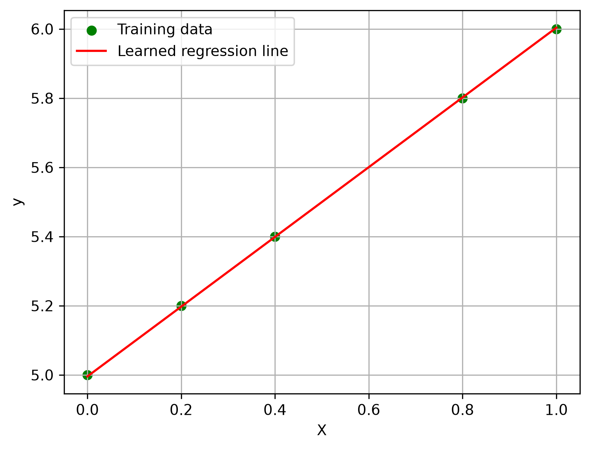

# Linear Regression from Scratch

A Python implementation of **Linear Regression from scratch using NumPy**, exploring the mathematical foundations and optimization process behind one of the fundamental machine learning algorithms.

The project focuses on understanding how linear regression works internally, rather than relying entirely on ready-made machine learning libraries.

## Project Objectives

- Understand the mathematics behind linear regression.
- Implement the cost function and its gradient using NumPy.
- Implement gradient descent from scratch.
- Explore brute-force parameter search.
- Apply the model to synthetic and real-world datasets.
- Evaluate the implementation against Scikit-learn.


## Mathematical Foundations

### 1. Linear Regression Model

The hypothesis function is:

$$
\hat{y} = w_0 + w_1x
$$

For multiple features:

$$
\hat{y} = w_0 + w_1x_1 + \cdots + w_nx_n
$$

### 2. Cost Function

We use the Mean Squared Error cost function with a factor of 1/2:

$$
J(w) = \frac{1}{2N}\sum_{i=1}^{N}(\hat{y}^{(i)}-y^{(i)})^2
$$

### 3. Gradient Descent

The parameters are updated iteratively:

$$
w_j := w_j - \alpha \frac{\partial J(w)}{\partial w_j}
$$

Where:
- $w_j$ is a model parameter.
- $\alpha$ is the learning rate.
- $\frac{\partial J(w)}{\partial w_j}$ is the partial derivative of the cost function.


## Project Structure

```text
linear-regression-from-scratch/
│
├── data/
│
├── src/
│   ├── __init__.py
│   ├── data_preparation.py
│   ├── cost_function.py
│   ├── gradient_descent.py
│   └── visualization.py
│
├── examples/
│   ├── 01_brute_force.py
│   ├── 02_linear_regression.py
│   └── 03_diabetes_dataset.py
│
├── main.py
└── requirements.txt
```

### Components

- **`data_preparation.py`**: Loads datasets, prepares features, and adds the intercept column.
- **`cost_function.py`**: Implements the cost function and its gradient.
- **`gradient_descent.py`**: Implements the optimization algorithm.
- **`visualization.py`**: Plots training data and regression predictions.
- **`examples/`**: Contains experiments using brute-force search, synthetic data, and the diabetes dataset.
- **`main.py`**: Runs the basic project pipeline.
- **`requirements.txt`**: Lists the project dependencies.


## Experiments

### 1. Brute-Force Search

Explores a simple parameter search approach by evaluating candidate slopes and intercepts and selecting the line with the lowest Mean Squared Error.

### 2. Linear Regression with Gradient Descent

Implements linear regression from scratch using NumPy.

- Synthetic dataset.
- Vectorized cost and gradient calculations.
- Gradient descent optimization.
- Visualization of the learned regression line.

### 3. Diabetes Dataset

Applies the implementation to Scikit-learn's diabetes dataset.

The experiment includes:
- Training and testing split (80/20).
- Feature standardization using `StandardScaler`.
- Training with the custom gradient descent implementation.
- Evaluation using MSE and R².
- Comparison with Scikit-learn's `LinearRegression`.


### Results

The custom implementation was evaluated against Scikit-learn's Linear Regression using the same training and test sets.

| Metric | From Scratch | Scikit-learn |
|---|---:|---:|
| Test MSE | 2900.1299 | 2900.1936 |
| Test R² | 0.452615 | 0.452603 |

Both implementations produce nearly identical results, validating the correctness of the gradient descent implementation.


## Visualization

The following plot shows the learned regression line compared with the training data.




## Installation

### 1. Clone the repository

```bash
git clone https://github.com/hosni55/linear-regression-from-scratch.git
cd linear-regression-from-scratch
```

### 2. Install dependencies

```bash
pip install -r requirements.txt
```

## Usage

Run the examples from the project root directory:

```bash
# Brute-force parameter search
python -m examples.01_brute_force

# Linear regression on synthetic data
python -m examples.02_linear_regression

# Linear regression on the diabetes dataset
python -m examples.03_diabetes_dataset
```

Run the main pipeline:

```bash
python main.py
```

## Technologies

- Python
- NumPy
- Matplotlib
- Scikit-learn

